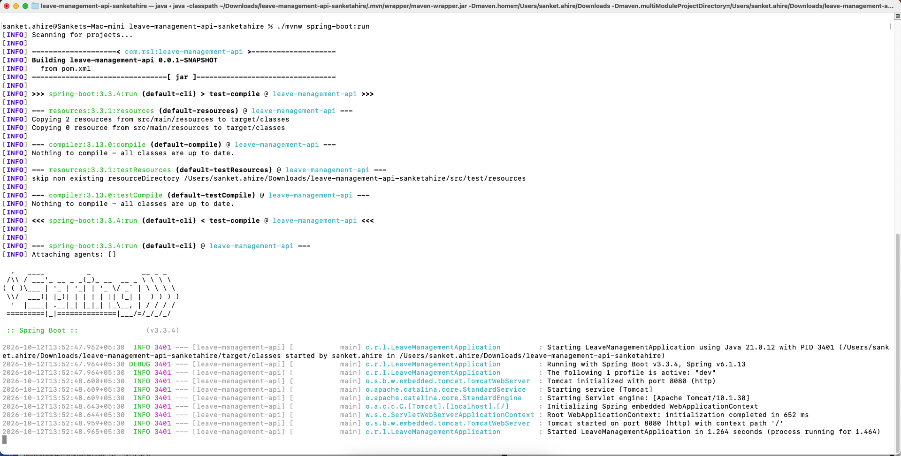
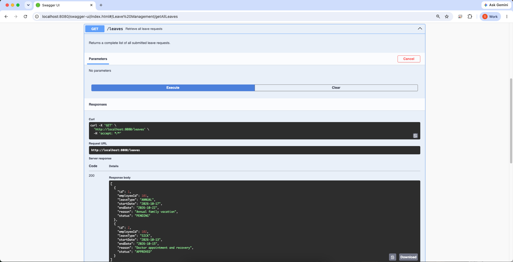
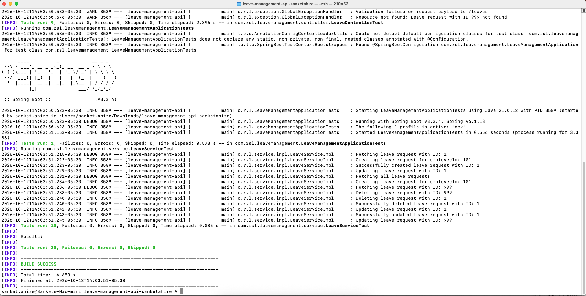

# Leave Management REST API

[](https://spring.io/projects/spring-boot)
[](https://openjdk.org/)
[](https://rajasoftwarelabs.com)

A production-grade, RESTful Leave Management API for an organization's HR system built with **Spring Boot 3.3.4** and **Java 21**. 

This application demonstrates enterprise backend architecture principles, including layered separation of concerns, constructor-based dependency injection, thread-safe in-memory storage, Jakarta Bean Validation, centralized global exception handling, externalized configuration with Spring profiles, interactive OpenAPI documentation, and automated testing with JUnit 5, Mockito, and MockMvc.

---

## Developer Metadata
- **Developer:** Sanket Ahire
- **Email:** [sanket.ahire@rajasoftwarelabs.com](mailto:sanket.ahire@rajasoftwarelabs.com)
- **Repository:** [https://github.com/rsllearning/leave-management-api-sanketahire](https://github.com/rsllearning/leave-management-api-sanketahire)
- **Target Branch:** `main`
- **Feature Branch:** `feature/leave-management-api`

---

## Architecture & Design Overview

The application strictly implements the **Layered Architecture** pattern:
```
Client (HTTP / Swagger / cURL)
             │
             ▼
      LeaveController           <── Request / Response DTOs & @Valid Bean Validation
             │
             ▼
        LeaveService            <── Business Rules, Date Invariants, Status Transitions
             │
             ▼
       LeaveRepository          <── Data Access Contract (Dependency Inversion)
             │
             ▼
   InMemoryLeaveRepository      <── ConcurrentHashMap & AtomicLong (Thread-Safe)
```

```mermaid
flowchart TD
    Client["Client (Postman / cURL / Browser)"] -->|HTTP Requests| Controller["LeaveController (@RestController)"]
    Controller -->|DTO Validation (@Valid)| Controller
    Controller -->|Delegates to| Service["LeaveService / LeaveServiceImpl (@Service)"]
    Service -->|Business Logic & Date Validation| Service
    Service -->|Constructor DI| Repository["LeaveRepository / InMemoryLeaveRepository (@Repository)"]
    Repository -->|Thread-Safe Storage| Store[("ConcurrentHashMap<Long, LeaveRequest> + AtomicLong")]
    
    Controller -.->|Exception Thrown| Advisor["GlobalExceptionHandler (@RestControllerAdvice)"]
    Advisor -.->|Standardized ErrorResponse JSON| Client
```

### Key Architectural Highlights:
1. **Loose Coupling & Immutability:** Pure **Constructor Injection** with `private final` fields across all layers. Zero field-based `@Autowired` usage.
2. **Data Decoupling:** Internal domain models (`LeaveRequest`) are never directly exposed to HTTP clients. Specialized DTOs (`CreateLeaveRequestDto`, `UpdateLeaveRequestDto`, `LeaveResponseDto`) define API contracts and prevent over-posting vulnerabilities.
3. **Thread-Safe In-Memory Persistence:** Uses `ConcurrentHashMap<Long, LeaveRequest>` and `AtomicLong idSequence` to guarantee consistency across concurrent worker threads without race conditions.
4. **Declarative Validation:** Enforces input constraints (`@NotNull`, `@Positive`, `@FutureOrPresent`, `@NotBlank`, `@Size`) at the web layer before execution enters the service layer.
5. **Business Invariant Enforcement:** Service validates cross-field date rules (ensuring `endDate` is on or after `startDate`) and defaults leave status to `PENDING` upon creation.
6. **Centralized Error Handling:** Global `@RestControllerAdvice` translates domain exceptions (`LeaveNotFoundException`, `InvalidLeaveDateException`, `MethodArgumentNotValidException`) into standardized `ErrorResponse` objects with appropriate HTTP status codes (400, 404, 500).

---

## Package Structure (7 Mandated Packages)

The project organizes code into the 7 mandated functional packages:

```
com.rsl.leavemanagement
├── LeaveManagementApplication.java       # Main Spring Boot bootstrap entry point
├── controller/
│   └── LeaveController.java             # REST Controller exposing CRUD endpoints
├── service/
│   ├── LeaveService.java                # Business service interface
│   └── impl/
│       └── LeaveServiceImpl.java        # Business logic & invariant validation
├── repository/
│   ├── LeaveRepository.java             # Persistence interface contract
│   └── impl/
│       └── InMemoryLeaveRepository.java # Thread-safe ConcurrentHashMap repository
├── model/
│   ├── LeaveRequest.java                # Domain model entity
│   ├── LeaveType.java                   # Enum: CASUAL, SICK, ANNUAL, MATERNITY, PATERNITY, UNPAID
│   └── LeaveStatus.java                 # Enum: PENDING, APPROVED, REJECTED, CANCELLED
├── dto/
│   ├── request/
│   │   ├── CreateLeaveRequestDto.java   # Payload for leave creation
│   │   └── UpdateLeaveRequestDto.java   # Payload for leave update
│   └── response/
│       ├── LeaveResponseDto.java        # Public presentation model
│       └── ErrorResponse.java           # Standardized JSON error schema
├── exception/
│   ├── LeaveNotFoundException.java      # Thrown on 404 resource lookup failure
│   ├── InvalidLeaveDateException.java   # Thrown on 400 invalid date range
│   └── GlobalExceptionHandler.java      # @RestControllerAdvice centralized error translator
└── configuration/
    └── OpenApiConfig.java               # Swagger UI and OpenAPI v3 configuration
```

---

## Technology Stack & Prerequisites

| Technology | Version | Purpose |
| :--- | :--- | :--- |
| **Java** | OpenJDK 21 | Programming language runtime |
| **Spring Boot** | 3.3.4 | Core enterprise application framework |
| **Spring MVC** | 6.1.13 | REST API and HTTP request mapping |
| **Jakarta Validation** | 3.0.2 | Declarative Bean Validation |
| **SpringDoc OpenAPI** | 2.6.0 | Interactive Swagger UI API documentation |
| **JUnit 5 Jupiter** | 5.10.3 | Automated testing framework |
| **Mockito** | 5.11.0 | Mocking framework for unit tests |
| **Spring Test / MockMvc**| 6.1.13 | Controller web-slice testing |
| **Apache Maven** | 3.9+ | Build automation and dependency management |

---

## Build & Run Instructions

### 1. Build the Application
Clone the repository and build the executable JAR using the bundled Maven Wrapper:
```bash
./mvnw clean package
```

### 2. Run the Application
Start the application using the Maven Spring Boot plugin (defaults to the `dev` profile):
```bash
./mvnw spring-boot:run
```
Or run the packaged JAR directly:
```bash
java -jar target/leave-management-api-0.0.1-SNAPSHOT.jar
```

The application will start on port **`8080`**.

### 3. Interactive API Documentation (Swagger UI)
Once started, access the interactive OpenAPI documentation and test endpoints in your browser:
* **Swagger UI:** [http://localhost:8080/swagger-ui.html](http://localhost:8080/swagger-ui.html)
* **OpenAPI JSON Spec:** [http://localhost:8080/v3/api-docs](http://localhost:8080/v3/api-docs)

---

## REST API Reference

| HTTP Method | Endpoint Path | Description | Request Body | Success Status | Error Status |
| :---: | :--- | :--- | :---: | :---: | :---: |
| **`GET`** | `/leaves` | Retrieve all leave requests | None | `200 OK` | `500` |
| **`GET`** | `/leaves/{id}` | Retrieve leave request by ID | None | `200 OK` | `404` |
| **`POST`** | `/leaves` | Create a new leave request | `CreateLeaveRequestDto` | `201 Created` | `400` |
| **`PUT`** | `/leaves/{id}` | Update an existing leave request | `UpdateLeaveRequestDto` | `200 OK` | `400`, `404` |
| **`DELETE`**| `/leaves/{id}` | Delete a leave request by ID | None | `204 No Content`| `404` |

---

## Sample cURL Requests & JSON Payloads

### 1. Retrieve All Leaves
```bash
curl -X GET http://localhost:8080/leaves -H "Accept: application/json"
```
**Response (`200 OK`):**
```json
[
  {
    "id": 1,
    "employeeId": 101,
    "leaveType": "ANNUAL",
    "startDate": "2026-10-17",
    "endDate": "2026-10-22",
    "reason": "Annual family vacation",
    "status": "PENDING"
  },
  {
    "id": 2,
    "employeeId": 102,
    "leaveType": "SICK",
    "startDate": "2026-10-13",
    "endDate": "2026-10-15",
    "reason": "Doctor appointment and recovery",
    "status": "APPROVED"
  }
]
```

### 2. Retrieve Leave by ID
```bash
curl -X GET http://localhost:8080/leaves/1 -H "Accept: application/json"
```
**Response (`200 OK`):**
```json
{
  "id": 1,
  "employeeId": 101,
  "leaveType": "ANNUAL",
  "startDate": "2026-10-17",
  "endDate": "2026-10-22",
  "reason": "Annual family vacation",
  "status": "PENDING"
}
```

### 3. Create a New Leave Request
```bash
curl -X POST http://localhost:8080/leaves \
  -H "Content-Type: application/json" \
  -d '{
    "employeeId": 105,
    "leaveType": "CASUAL",
    "startDate": "2026-10-20",
    "endDate": "2026-10-22",
    "reason": "Personal family event"
  }'
```
**Response (`201 Created`):**
```json
{
  "id": 3,
  "employeeId": 105,
  "leaveType": "CASUAL",
  "startDate": "2026-10-20",
  "endDate": "2026-10-22",
  "reason": "Personal family event",
  "status": "PENDING"
}
```

### 4. Update an Existing Leave Request
```bash
curl -X PUT http://localhost:8080/leaves/1 \
  -H "Content-Type: application/json" \
  -d '{
    "leaveType": "ANNUAL",
    "startDate": "2026-10-18",
    "endDate": "2026-10-24",
    "reason": "Extended annual family vacation",
    "status": "APPROVED"
  }'
```
**Response (`200 OK`):**
```json
{
  "id": 1,
  "employeeId": 101,
  "leaveType": "ANNUAL",
  "startDate": "2026-10-18",
  "endDate": "2026-10-24",
  "reason": "Extended annual family vacation",
  "status": "APPROVED"
}
```

### 5. Delete a Leave Request
```bash
curl -X DELETE http://localhost:8080/leaves/1
```
**Response (`204 No Content`)**

### 6. Validation Error Example (Bean Validation)
Submitting an invalid payload (missing employeeId and blank reason):
```bash
curl -X POST http://localhost:8080/leaves \
  -H "Content-Type: application/json" \
  -d '{
    "leaveType": "ANNUAL",
    "startDate": "2026-10-20",
    "endDate": "2026-10-22",
    "reason": ""
  }'
```
**Response (`400 Bad Request`):**
```json
{
  "timestamp": "2026-10-12T13:43:27.196",
  "status": 400,
  "error": "Bad Request",
  "message": "Validation failed for one or more fields",
  "path": "/leaves",
  "validationErrors": {
    "employeeId": "Employee ID is required",
    "reason": "Reason is required"
  }
}
```

### 7. Invalid Date Range Error Example (Business Rule)
Submitting `endDate` before `startDate`:
```bash
curl -X POST http://localhost:8080/leaves \
  -H "Content-Type: application/json" \
  -d '{
    "employeeId": 105,
    "leaveType": "ANNUAL",
    "startDate": "2026-10-25",
    "endDate": "2026-10-20",
    "reason": "Vacation"
  }'
```
**Response (`400 Bad Request`):**
```json
{
  "timestamp": "2026-10-12T13:43:27.185",
  "status": 400,
  "error": "Bad Request",
  "message": "End date (2026-10-20) cannot be before start date (2026-10-25)",
  "path": "/leaves"
}
```

### 8. Resource Not Found Error Example
```bash
curl -X GET http://localhost:8080/leaves/999
```
**Response (`404 Not Found`):**
```json
{
  "timestamp": "2026-10-12T13:43:27.166",
  "status": 404,
  "error": "Not Found",
  "message": "Leave request with ID 999 not found",
  "path": "/leaves/999"
}
```

---

## Automated Testing Suite

The project includes unit, web-slice, and integration tests:

### Execute the Test Suite:
```bash
./mvnw clean test
```

### Test Suite Summary:
```
[INFO] Results:
[INFO] 
[INFO] Tests run: 20, Failures: 0, Errors: 0, Skipped: 0
[INFO] 
[INFO] ------------------------------------------------------------------------
[INFO] BUILD SUCCESS
[INFO] ------------------------------------------------------------------------
```

| Test Class | Layer Tested | Framework | Scenarios Covered |
| :--- | :--- | :--- | :--- |
| **`LeaveServiceTest`** | Service Layer | JUnit 5 + Mockito | Creation, atomic ID assignment, date range validation, retrieval, not-found exception, updates, status transitions, deletion. (10 tests) |
| **`LeaveControllerTest`** | Web / REST Layer | `@WebMvcTest` + `MockMvc` | HTTP mappings, status codes (200, 201, 204, 400, 404), JSON serialization, Bean Validation errors, date errors. (9 tests) |
| **`LeaveManagementApplicationTests`**| Spring Context | `@SpringBootTest` | Application context loading and dependency wiring validation. (1 test) |

---

## Deliverable Verification Screenshots

All required verification screenshots are captured and stored in the [`screenshots/`](./screenshots) directory:

### 1. Application Startup
Verification of application startup on embedded Tomcat port 8080 with the `dev` profile active:


### 2. REST API Execution (Swagger UI & Endpoints)
Verification of Swagger UI OpenAPI documentation and interactive endpoint execution:
- **Swagger UI Dashboard Overview:** [`02-rest-api-overview-swagger.png`](./screenshots/02-rest-api-overview-swagger.png)
- **OpenAPI DTO & Error Schemas:** [`02-rest-api-schemas-swagger.png`](./screenshots/02-rest-api-schemas-swagger.png)
- **`GET /leaves` Execution (200 OK):** [`02-rest-api-get-all-leaves.png`](./screenshots/02-rest-api-get-all-leaves.png)
- **`GET /leaves/{id}` Execution (200 OK):** [`02-rest-api-get-leave-by-id.png`](./screenshots/02-rest-api-get-leave-by-id.png)
- **Error Response Contract (404):** [`02-rest-api-response-contract-404.png`](./screenshots/02-rest-api-response-contract-404.png)



### 3. Test Suite Execution (20/20 Passing)
Verification of complete test suite passing cleanly with 0 failures:
- **Test Suite Start:** [`03-test-suite-execution-start.png`](./screenshots/03-test-suite-execution-start.png)
- **Test Suite Success Summary:** [`03-test-suite-success.png`](./screenshots/03-test-suite-success.png)



---

## Documentation References
The original training materials and assignment guidelines are available in the [`docs/`](./docs) folder:
* [`docs/Training.Material.Spring Boot.pdf`](./docs/Training.Material.Spring%20Boot.pdf)
* [`docs/Training.Assignment.Spring Boot.pdf`](./docs/Training.Assignment.Spring%20Boot.pdf)
